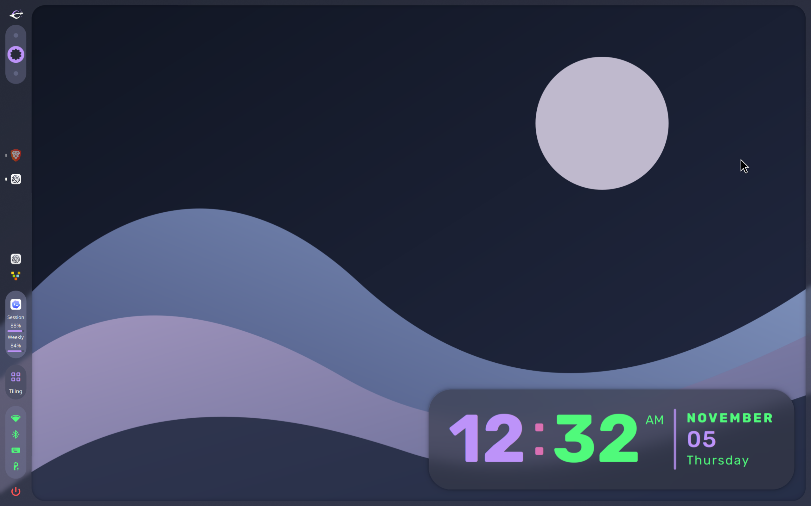
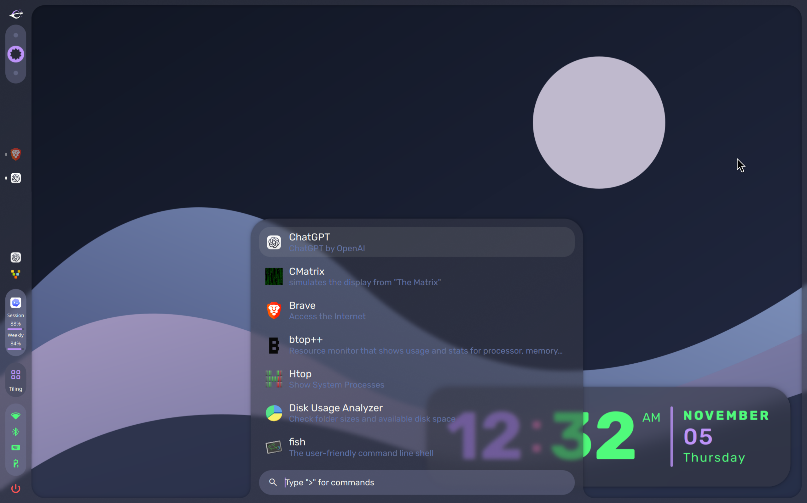
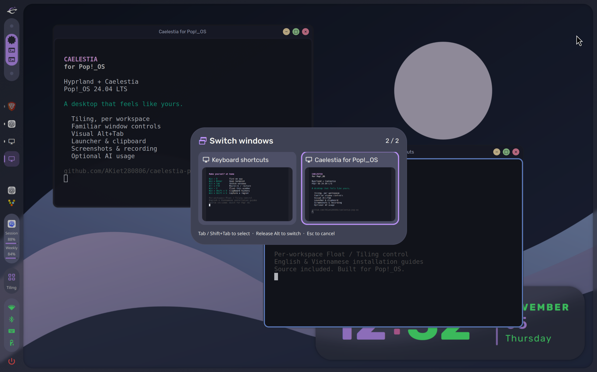
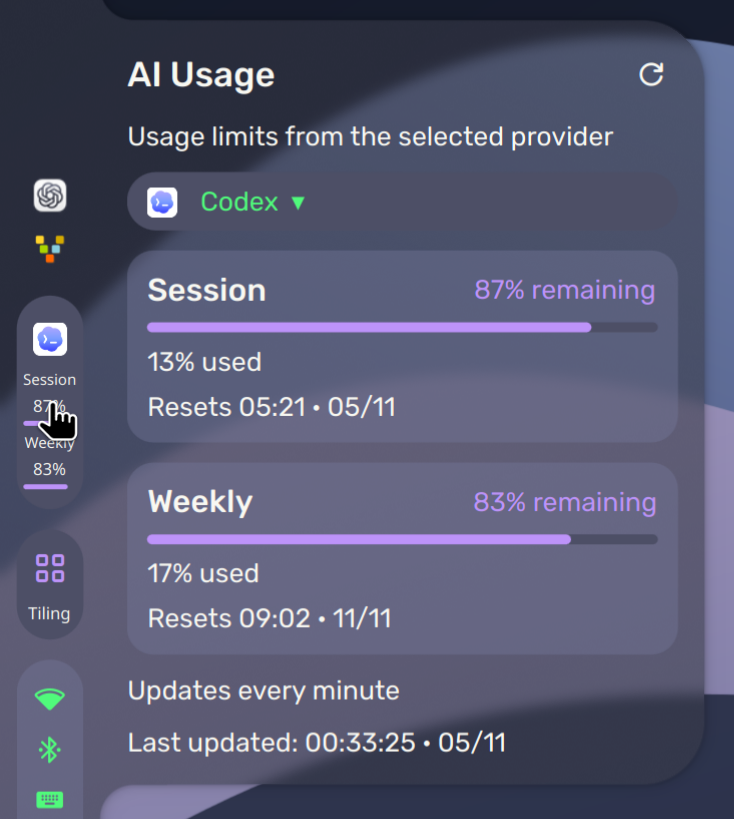
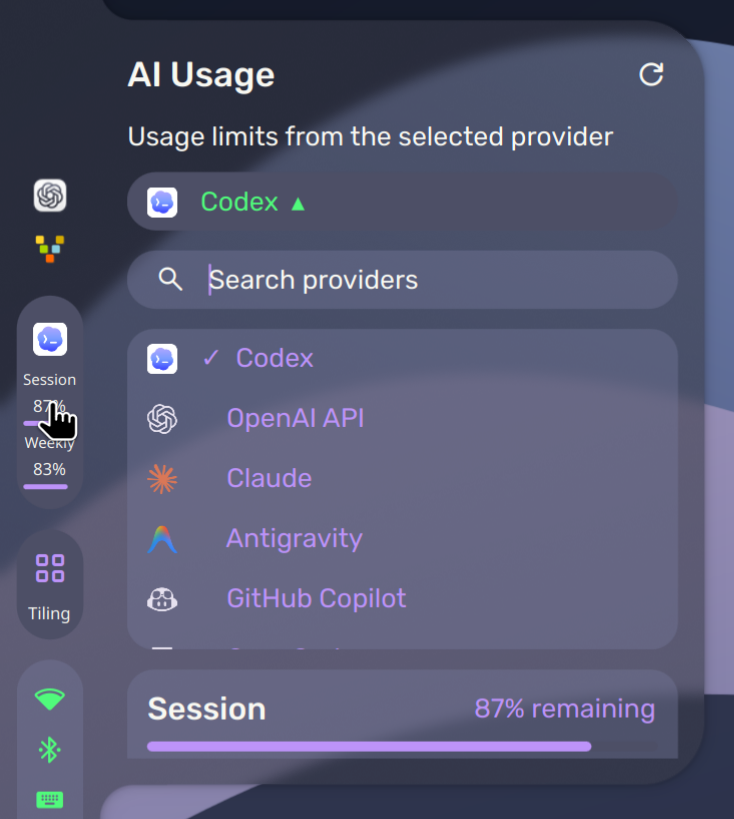
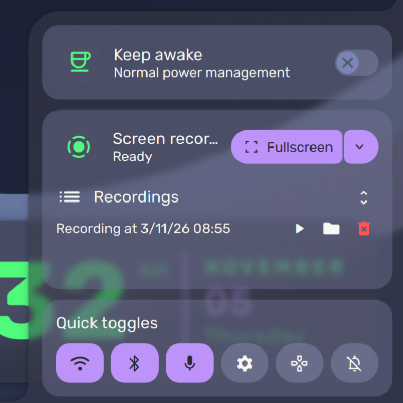
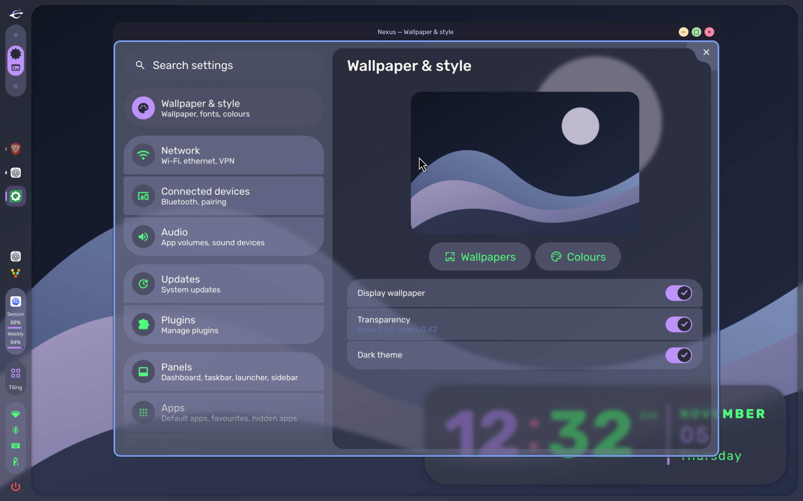
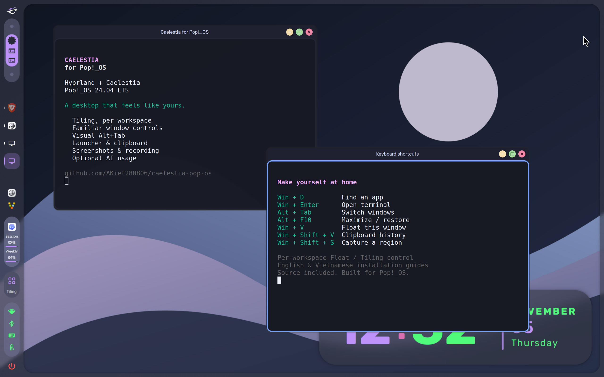
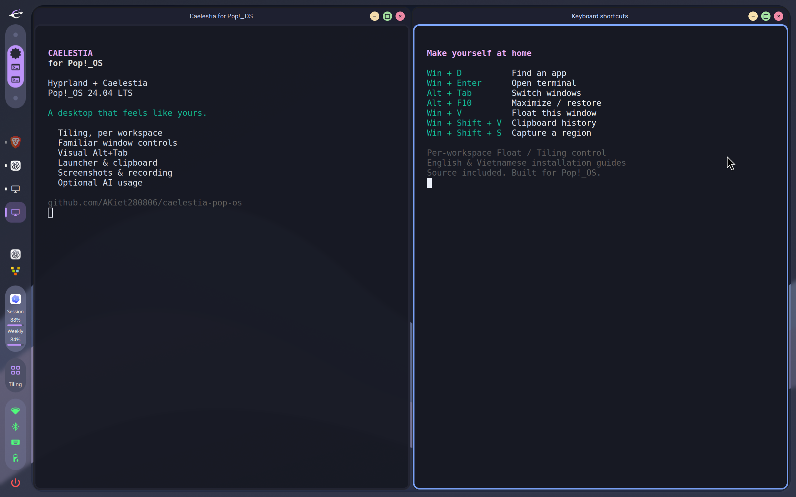

# Caelestia for Pop!_OS

A Hyprland desktop for **Pop!_OS 24.04**, with the Caelestia shell, familiar window controls, and a guided installation from COSMIC.

[](https://github.com/AKiet280806/caelestia-pop-os/actions/workflows/checks.yml)


[](LICENSE)

**[Install · English](docs/en/INSTALL.md)** · **[Cài đặt · Tiếng Việt](docs/vi/INSTALL.md)** · [Shortcuts](docs/en/USAGE.md) · [AI agent guide](docs/agent/INSTALL.md)



## Gallery

| Application launcher · Win+D | Visual window switcher · Alt+Tab |
| --- | --- |
| [](assets/screenshots/launcher.png) | [](assets/screenshots/window-switcher.png) |

| AI Usage · hover to open | Search and choose one provider |
| --- | --- |
| [](assets/screenshots/ai-usage.png) | [](assets/screenshots/ai-providers.png) |

| Screen recorder and quick controls | Wallpaper and style settings |
| --- | --- |
| [](assets/screenshots/utilities.png) | [](assets/screenshots/appearance.png) |

<details>
<summary>Floating and tiled window layouts</summary>

| Floating windows | Tiled windows |
| --- | --- |
| [](assets/screenshots/floating.png) | [](assets/screenshots/tiling.png) |

Each workspace remembers its Float/Tiling choice. New workspaces start tiled; Win+V changes an individual window.

</details>

Real desktop captures with the included [CC0 wallpaper](assets/wallpaper.svg) and a Dracula palette. Terminal text and window selection are staged for demonstration. Installed apps, scale and optional widgets depend on your setup. Click a thumbnail for the full desktop capture. [Screenshot details](assets/README.md).

## Features

- **Choose your layout.** Tiling by default, with a saved Float/Tiling preference for each workspace. Float an individual window with Win+V.
- **Familiar window controls.** Minimize, maximize/restore and close buttons, a running-app sidebar, and a visual Alt+Tab switcher that keeps your pointer in place.
- **A coordinated shell.** Translucent panels, application search, notifications, media controls, desktop clock and animated wallpaper changes with automatic fallback recovery.
- **Everyday tools included.** Foot, COSMIC Files, clipboard history, region screenshots and screen recording with speaker audio. Keep your existing default browser.
- **Optional extras.** Vietnamese Telex with Fcitx5 + Unikey, HyprMod settings, and [AI Usage](docs/AI-USAGE.md) for one provider you select.
- **Source included.** Modified QML/C++ shell, native window-action plugin, configuration and staged installer. Exact runtime revisions live in [pins.json](pins.json).

## Install from COSMIC

**0.2.0 is a pre-release.** The desktop has been used on an existing Pop!_OS machine; a complete clean-machine installation is still unverified. Keep COSMIC available as your recovery session. Read the [installation guide](docs/en/INSTALL.md) before making system changes.

Start in a COSMIC terminal:

```bash
sudo apt update
sudo apt install --no-remove git
mkdir -p "$HOME/Projects"
cd "$HOME/Projects"
git clone https://github.com/AKiet280806/caelestia-pop-os.git
cd caelestia-pop-os
./setup.sh preflight
./setup.sh plan
./setup.sh install --dry-run
```

After reviewing the plan and prerequisites:

```bash
./setup.sh install --yes
./setup.sh doctor
```

Run as your normal user; the installer requests `sudo` for system changes. It downloads and compiles the runtime, then adds **Hyprland (Caelestia Pop!_OS)** to the COSMIC Greeter session menu. Save your work and follow the guide to log into the new session.

| Requirement | Default / support |
| --- | --- |
| Operating system | Pop!_OS 24.04 LTS, amd64 |
| Disk budget | 20 GiB free when build, runtime and reserve share a filesystem: 8 + 4 + 8 GiB |
| Build parallelism | 2 jobs |
| Display scale | 1.0; choose a suitable value with `--scale` |
| Graphics | Intel + NVIDIA laptop runtime exercised; other GPUs and multiple displays need testing |

COSMIC, its greeter, System76 power management and distribution NVIDIA drivers stay installed. The installer does not automatically log you out or reboot.

<details>
<summary>Optional features and installer commands</summary>

Choose only the options you need; this example enables all three extras:

```bash
./setup.sh install --yes --vietnamese --with-hyprmod --with-ai-usage --scale 1.5
```

`--with-codex` remains an alias for `--with-ai-usage`. AI Usage displays one selected provider; Codex account limits are separate from ordinary ChatGPT usage.

| Command | Purpose |
| --- | --- |
| `preflight` / `plan` | Inspect prerequisites and proposed changes |
| `install` | Run package, runtime, plugin and deployment stages |
| `packages` / `runtime` / `plugins` / `deploy` | Run an individual stage |
| `doctor` | Inspect the installed environment and current session |
| `rollback --backup latest --yes` | Restore managed configuration; retain shared packages |
| `clean-cache --yes` | Remove build directories; retain downloads, sources and receipts |

Prefix commands with `./setup.sh`. All accept `--dry-run`. See `./setup.sh --help` and the [full option reference](docs/en/INSTALL.md#choose-your-options).

</details>

## Documentation

| Guide | English | Tiếng Việt |
| --- | --- | --- |
| From COSMIC to the first Hyprland login | [Installation](docs/en/INSTALL.md) | [Cài đặt](docs/vi/INSTALL.md) |
| Build and install each component yourself | [Manual installation](docs/en/MANUAL.md) | [Cài thủ công](docs/vi/MANUAL.md) |
| Windows, shortcuts, screenshots and recording | [Usage](docs/en/USAGE.md) | [Cách dùng](docs/vi/USAGE.md) |
| Session, graphics, portals, fonts and input | [Troubleshooting](docs/en/TROUBLESHOOTING.md) | [Khắc phục lỗi](docs/vi/TROUBLESHOOTING.md) |
| Updates, rollback, uninstall and COSMIC recovery | [Maintenance](docs/en/MAINTENANCE.md) | [Bảo trì và khôi phục](docs/vi/MAINTENANCE.md) |
| Reclaim disk space | [Optional cleanup](docs/en/COSMIC-CLEANUP.md) | [Dọn dung lượng](docs/vi/COSMIC-CLEANUP.md) |

For an AI-assisted installation, start with [AGENTS.md](AGENTS.md) and the [agent installation guide](docs/agent/INSTALL.md). Provider setup is covered in [AI Usage](docs/AI-USAGE.md).

## Contributing and support

Bug reports, documentation fixes and improvements are welcome. Read [CONTRIBUTING.md](CONTRIBUTING.md) for source layout, local checks and contribution guidelines. [Open an issue](https://github.com/AKiet280806/caelestia-pop-os/issues/new/choose) with reproduction steps and sanitized diagnostics.

The runtime pins Hyprland 0.57.0 from `ppa:cppiber/hyprland`, Quickshell 0.3.1, Caelestia 2.5.0, private Qt 6.11.2 and private Wayland 1.26. Native plugins must match the compositor ABI. See the manual guide before changing dependencies. Fresh installs, suspend/resume, multiple displays and other GPU combinations remain areas for further validation.

## Credits and license

Built on [Caelestia shell](https://github.com/caelestia-dots/shell), [Caelestia CLI](https://github.com/caelestia-dots/cli), [Quickshell](https://quickshell.org/) and [Hyprland](https://hypr.land/). Inspired by [12errh/caelestia-ubuntu](https://github.com/12errh/caelestia-ubuntu).

Distributed under [GPL-3.0-or-later](LICENSE), with component licenses and attribution in [NOTICE](NOTICE), [shell/LICENSE](shell/LICENSE) and [licenses/](licenses/). The included wallpaper is CC0. This is a community project, independent of System76 and upstream Caelestia.
